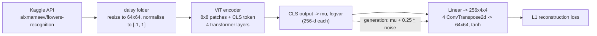

# ViT Autoencoder Image Generation

A small Google Colab project that uses Vision Transformer components for 64x64 image generation on the Kaggle *Flowers Recognition* dataset (daisy class only). A ViT-style encoder (patch embedding, class token, learnable positional embeddings and `nn.TransformerEncoder` layers) compresses each image into a latent vector, and a transposed-convolution decoder reconstructs it. New "daisy-like" images are produced by adding Gaussian noise to the latent vectors of real images and decoding them.

This is a university assignment; the aim is to show how transformer encoder layers can be used inside an image generation pipeline, not to produce photorealistic images.

## Repository contents

```text
vit-autoencoder-image-generation/
├── rewan_vit_image_generation_assignment_colab.ipynb        # main notebook, executed (outputs included)
├── improved_vit_image_generation_assignment_colab_v2.ipynb  # experimental variant, not executed
├── ViT_Image_Generation_Report.docx                         # written report (theory overview + implementation)
└── README.md
```

## Main notebook (`rewan_vit_image_generation_assignment_colab.ipynb`)

### Pipeline



### Model

| Part | Configuration |
|---|---|
| Patch embedding | `Conv2d` with kernel and stride 8: 64 patches of 128-d |
| Tokens | Learnable class token and positional embeddings (65 positions) |
| Transformer encoder | 4 `nn.TransformerEncoderLayer` layers, 4 heads, model dim 128, feed-forward dim 512, GELU, dropout 0.1, pre-norm |
| Latent | Two linear heads on the class-token output: `mu` and `logvar`, 256-d each |
| Decoder | Linear to 256x4x4, then four `ConvTranspose2d` (stride 2) layers with BatchNorm + ReLU to 64x64x3, `tanh` output |
| Parameters | 2,635,299 trainable (printed in the notebook) |

The class is named `ViTVAE` and its forward pass samples `z = mu + exp(0.5 * logvar) * eps`, but **training uses only an L1 reconstruction loss**. A `vae_loss` function with a KL term is defined but never called, so no KL regularisation is applied and the model is, in practice, a ViT autoencoder (with a stochastic bottleneck) rather than a trained VAE.

### Training setup

| Setting | Value |
|---|---|
| Data | Kaggle `alxmamaev/flowers-recognition`, `daisy` class only; 764 images found and all used (cap of 900) |
| Preprocessing | Resize and centre-crop to 64x64, normalise to [-1, 1]; no augmentation |
| Batch size | 64 |
| Optimiser | AdamW, lr 2e-4, weight decay 1e-4, gradient clipping at 1.0 |
| Loss | `nn.L1Loss` between reconstruction and input |
| Epochs | 30 |
| Seed | 42 |

### Generation

The notebook does not sample from a prior. It encodes 16 real training images, takes their `mu` vectors, adds Gaussian noise with standard deviation 0.25 and decodes the result. The outputs are therefore perturbed reconstructions of real images. The notebook explains that fully random latent vectors produced noisy images with this model.

### Results

Printed in the executed notebook (Colab, T4 GPU): mean L1 training loss per epoch went from **0.5724** (epoch 1) to **0.3097** (epoch 30). The loss is measured on images normalised to [-1, 1], on the training set; there is no validation split and no image-quality metric. The notebook also shows a loss curve, an original-vs-reconstruction grid and a grid of generated images as embedded figures.

## Experimental v2 notebook (`improved_vit_image_generation_assignment_colab_v2.ipynb`)

An unexecuted variant (no outputs) that keeps the same data pipeline and training hyperparameters and changes the model:

- patch size 4 (256 patches) instead of 8;
- a single deterministic latent projection (`fc_latent`) instead of `mu`/`logvar`;
- a deeper decoder (five `ConvTranspose2d` layers with GELU plus a final 3x3 `Conv2d`);
- generation noise standard deviation 0.08.

Its markdown describes the model as a VAE trained with reconstruction + KL loss, but the code does not match that description, and the notebook will not run as written:

- `ViTAutoencoder.forward` returns two values (`reconstructed, latent`), but the training loop and the reconstruction cell unpack three (`recon, mu, logvar = model(batch)`), which raises a `ValueError`.
- The training loop calls `vae_loss(recon, batch, mu, logvar)`, but the model produces no `mu` or `logvar`.
- The generation cell does `real_images, _ = next(iter(train_loader))`, but the dataset returns images only (no labels), so this unpacking also fails.

Treat it as an experimental draft with known issues.

## Running the notebook

Prerequisites: a Google account (Colab) and a Kaggle account.

1. Open `rewan_vit_image_generation_assignment_colab.ipynb` in Google Colab and select a GPU runtime (Runtime > Change runtime type > GPU).
2. In Kaggle account settings, create an API token; this downloads `kaggle.json`.
3. Run the cells in order. The first cell installs the `kaggle` package; the upload cell opens a file picker where you select `kaggle.json` (renamed copies such as `kaggle (1).json` are accepted). The token is copied to `~/.kaggle/kaggle.json`, and the dataset is downloaded and extracted to `/content/flowers_dataset`.
4. Training runs for 30 epochs; the following cells plot the loss, the reconstructions and the generated images.

The notebook relies on `google.colab` and Colab's preinstalled PyTorch, torchvision, NumPy, Pillow and matplotlib, so running it locally requires replacing the upload step and installing those packages.

## Limitations

- Single class, 764 images, 64x64 resolution and 30 epochs; outputs are expected to be blurry.
- No KL term in training, so the latent space is not regularised and random latent sampling is not supported; "generation" means perturbing latents of real images.
- No held-out evaluation or quantitative image-quality metric (e.g. FID).
- No trained weights are saved or committed.
- The v2 notebook has not been executed and contains the bugs listed above.

## Future improvements (ideas)

- Fix the v2 unpacking issues and either add the KL term (true VAE) or document it as a plain autoencoder.
- Add a validation split and an image-quality metric.
- Train on more classes or more data and compare patch sizes.

## References

- Dosovitskiy et al., *An Image is Worth 16x16 Words: Transformers for Image Recognition at Scale*, ICLR 2021.
- Kingma and Welling, *Auto-Encoding Variational Bayes*, ICLR 2014.
- Vaswani et al., *Attention Is All You Need*, NeurIPS 2017.
- Mamaev, *Flowers Recognition* dataset, Kaggle, 2018.

## Author

Rewan Hany
